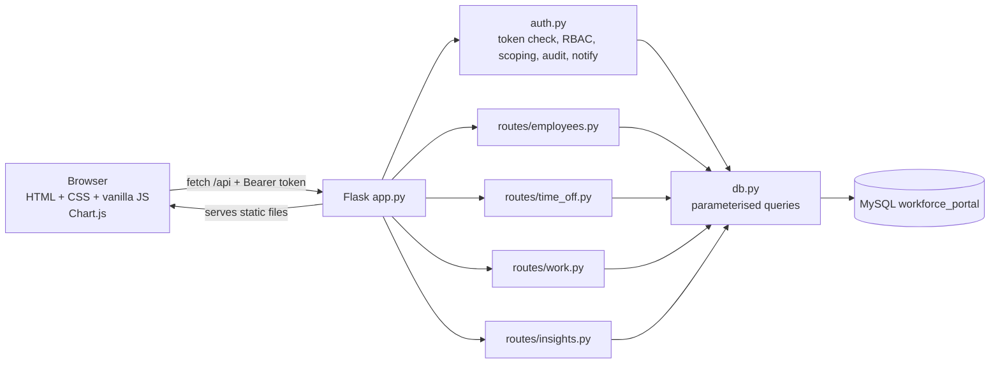
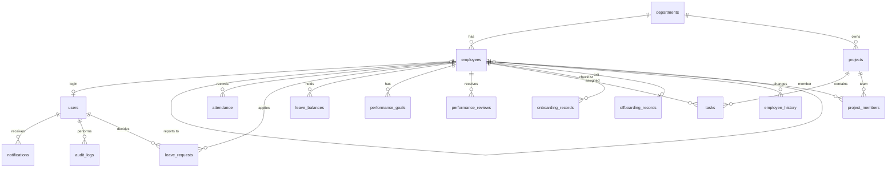

# System architecture & database design (Mermaid — renders on GitHub)

## Architecture

## Database relationships

Extra tables beyond the brief's 14: `project_members`, `employee_history` (profile update history), `login_logs`, `settings`.
